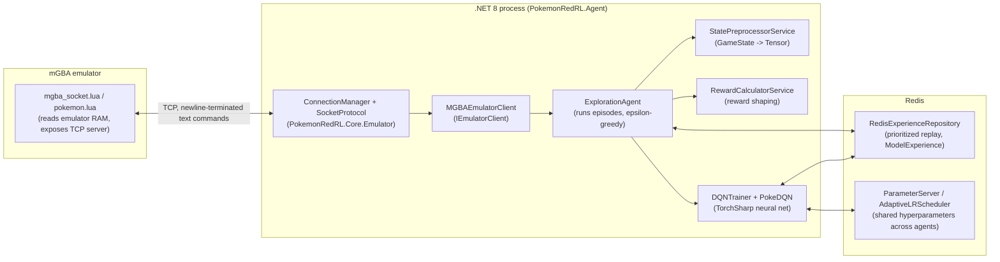
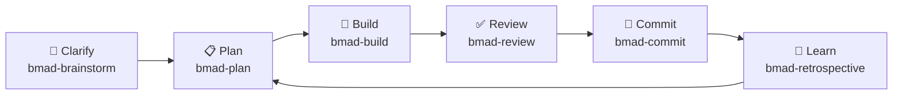

# Copilot Instructions — PokemonRedRL

These are repository-wide custom instructions for GitHub Copilot / AI coding agents working in this repo. Read this before making changes.

## What this project is

PokemonRedRL trains a Reinforcement Learning (DQN) agent to play **Pokémon Red** through the **mGBA** emulator. A Lua script running inside mGBA exposes game memory over a TCP socket; a .NET 8 application reads game state, decides actions, executes them back through the socket, and trains a neural network (TorchSharp) from the resulting experience, persisted in Redis.



Multiple `ExplorationAgent` instances can run concurrently (see `NUMBER_OF_AGENTS` in `Program.cs`), each talking to its own mGBA instance/port, sharing experience and hyperparameters through Redis.

## Solution / project layout

Root solution: [src/PokemonRedRL.sln](../src/PokemonRedRL.sln)

| Project | Responsibility |
|---|---|
| `PokemonRedRL.Agent` | Entry point (`Program.cs`), DI composition root, `ExplorationAgent` (episode loop, epsilon-greedy action selection, experience creation) |
| `PokemonRedRL.Core` | Emulator I/O: `ConnectionManager` (TCP connect/retry), `SocketProtocol` (command/response framing), `MGBAEmulatorClient` (`IEmulatorClient`), `ActionExecutor`, `NetworkConfig(Factory)`, `RewardCalculatorService`, `StatePreprocessorService` |
| `PokemonRedRL.Models` | RL core: `PokeDQN` (TorchSharp `Module`, 3-layer MLP), `DQNTrainer` (training step, action selection, TD-error/priority updates), `AdaptiveLRScheduler`, `ExperienceReplay`, `SumTree` (prioritized replay), `ParameterServer`, `RedisExperienceRepository` (`IExperienceRepository`), `RedisMaintenanceService`, `RedisConfig` |
| `PokemonRedRL.DAL` | Plain data models: `GameState`, `GameStateResponse`, `PokemonData` |
| `PokemonRedRL.Utils` | Cross-cutting helpers: `Enums` (`Buttons`, `ActionType`), `GameStateSerializer`, `TensorExtensions` |
| `src/scripts/mgba_socket.lua`, `src/mGBA-0.10.5-win64/scripts/*.lua` | Lua side of the bridge, loaded inside mGBA (`pokemon.lua` reads party/species/memory, `mgba_socket.lua` runs the socket server) |
| `src/data/` | ROMs, save states, and JSON metadata (`events_data.json`, `map_data.json`) used by the emulator/agent |
| `programs/` | Third-party installers/archives (Lua, LuaRocks, luasocket, mGBA, TDM-GCC) used to set up the local environment — not project source |

A full, generated file-by-file map lives in [docs/CODEBASE_MAP.md](../docs/CODEBASE_MAP.md). **Regenerate it (via the `/cartograph` prompt) whenever you add, remove, or move files/projects** — do not let it go stale.

A narrative "what/why" companion doc — motivation, RL approach, design tradeoffs, and known gaps/inconsistencies — lives in [docs/PROJECT_OVERVIEW.md](../docs/PROJECT_OVERVIEW.md). Read it before making non-trivial changes; update it if you discover a new design-level inconsistency or resolve a listed one.

The **single source of truth** for project state is [docs/PROJECT_SPEC.md](../docs/PROJECT_SPEC.md). It consolidates all completed tasks, the active epic with subtask status, key decisions, open risks, and artifact links. **Read it first** when starting any task. **Update it** at the checkpoints defined in each BMAD prompt (plan → add task, review → update status, commit → mark done, retro → add lessons). Never hand-edit status fields — let the prompts do it.

Each non-trivial task gets a committed plan file at `docs/tasks/<slug>.md` (created by `/bmad-plan`, updated through `/bmad-review` → `/bmad-build` → `/bmad-commit`, tracking a `Status:` field and a step checklist). These are kept in the repo as a durable record of what was planned and done — do not delete or gitignore `docs/tasks/`.

**Task archiving:** When a task reaches `✅ Done` (via `/bmad-commit`), its file is moved to `docs/tasks/archive/<slug>.md`. Only the active epic roadmap and in-progress/planned tasks stay in `docs/tasks/`. The epic roadmap itself is archived only when the entire epic is `Completed`. This keeps the working directory clean — `docs/tasks/` always contains exactly what's being worked on right now.

## Conventions actually used in this codebase

- Target framework: **.NET 10.0**, `Nullable` and `ImplicitUsings` enabled in every `.csproj`.
- Dependency injection via `Microsoft.Extensions.Hosting` `Host.CreateDefaultBuilder` in `Program.cs`. New services should be registered there, following the existing `AddSingleton`/`AddScoped` pattern (services that hold per-agent/per-connection state are `Scoped`; shared infra like `ParameterServer`, `AdaptiveLRScheduler` are `Singleton`).
- Interfaces live in an `Interfaces/` folder next to the code they abstract (`IEmulatorClient`, `IRewardCalculatorService`, `IStatePreprocessorService`, `IExperienceRepository`) and are implemented in a sibling `Services/`/`Emulator/` folder.
- TorchSharp is used directly (`static TorchSharp.torch`, `TorchSharp.Modules`); tensors are created/disposed manually — watch for tensor leaks when editing training code (wrap in `using`/`DisposeScope` where reasonable instead of introducing new leaks).
- The emulator protocol is a simple newline-terminated text command/response over a raw `TcpClient` (`SocketProtocol.SendCommand`). Any new command must be handled on both the C# side and the Lua side.
- Existing code comments/log messages are a mix of Russian and English (the author's working language). Match the surrounding file's language when editing an existing block; new files/comments should default to concise English.
- No automated test project currently exists in the solution. If you add meaningful logic, prefer adding a test project (`xUnit`, matching `net10.0`) rather than skipping verification.
- `src/data/roms/` (ROMs, `.sav`/`.ss*` save states) and model backups under `src/data/models/` are **intentionally committed** to this repo as working backups — do not add them to `.gitignore` or untrack them without explicit user confirmation.

## Build & run

### Quick start (Docker Compose — recommended)

```bash
# Start Redis + Agent (backend only; mGBA + ControlPanel still run on Windows host)
docker compose up -d

# Check logs
docker compose logs -f agent

# Stop (preserves training data)
docker compose down

# Nuclear option (deletes all training data)
docker compose down -v
```

The `docker-compose.yml` defines two services:
- **`redis`** — `redis/redis-stack-server:latest` with RediSearch, port 6379, persistent named volume
- **`agent`** — the .NET Agent built from `Dockerfile`, connects to Redis at `redis:6379` and mGBA at `host.docker.internal`

Environment variables for the Agent container:
- `REDIS_CONNECTION` (default: `redis:6379`) — DI singleton connection
- `REDIS_HOST` / `REDIS_PORT` (default: `redis` / `6379`) — `RedisExperienceRepository` connection
- CLI args: `--host host.docker.internal --port 12345 --agent-index 0`

### Manual host-native run (fallback / advanced)

- Requires: .NET 10 SDK, a running Redis instance on `localhost:6379`, mGBA 0.10.5 with `mgba_socket.lua` loaded against a Pokémon Red/FireRed ROM.
- Build: `dotnet build src/PokemonRedRL.sln`
- Run the agent: `dotnet run --project src/PokemonRedRL.Agent`
- Run with custom Redis: `REDIS_CONNECTION=localhost:6379 REDIS_HOST=localhost REDIS_PORT=6379 dotnet run --project src/PokemonRedRL.Agent`
- Run with custom mGBA host: `dotnet run --project src/PokemonRedRL.Agent -- --host 127.0.0.1 --port 12345`
- There is currently no CI workflow in `.github/` — builds/tests are run locally.

## Agentic workflow for this repo (BMAD-adapted)

This project uses a **BMAD-adapted workflow** (Breakthrough Method for Agile Ai Driven Development). The workflow has four phases:



### Quick Reference

| Phase | Prompt | Agent Persona | Output |
|---|---|---|---|
| Brainstorm | `/bmad-brainstorm` | Mary (Analyst) | `_bmad-output/brainstorm-<topic>.md` |
| Plan | `/bmad-plan` | John (PM) / Winston (Architect) | `docs/tasks/<slug>.md` or `_bmad-output/spec-<slug>/` |
| Build | `/bmad-build` | Amelia (Developer) | Code changes |
| Review | `/bmad-review` | — | Review report |
| Commit | `/bmad-commit` | — | Git commit |
| Code Review | `/bmad-code-review` | — | Code review report |
| Architecture | `/bmad-architecture` | Winston (Architect) | `docs/adr/<date>-<slug>.md` |
| Retrospective | `/bmad-retrospective` | — | `_bmad-output/retro-<slug>.md` |

### Planning Depths

| Depth | When | Prompts |
|---|---|---|
| **Light** | Bug fix, config change | `/bmad-plan` → `/bmad-build` → `/bmad-review` → `/bmad-commit` |
| **Standard** | Feature, refactor | `/bmad-plan` → `/bmad-architecture` (optional) → `/bmad-build` → `/bmad-review` → `/bmad-commit` |
| **Full** | Major feature, architecture change | `/bmad-brainstorm` → `/bmad-plan` → `/bmad-architecture` → `/bmad-build` → `/bmad-review` → `/bmad-commit` → `/bmad-retrospective` |

### Agent Personas

Load a persona by reading its file from `.github/agents/`:

| Agent | File | Icon | Role |
|---|---|---|---|
| Amelia (Developer) | `.github/agents/amelia-dev.md` | 💻 | Implements code strictly to spec, test-first discipline |
| John (PM) | `.github/agents/john-pm.md` | 📋 | Creates plans, specs, user stories; outcome-driven |
| Winston (Architect) | `.github/agents/winston-architect.md` | 🏗️ | Designs components, data flow, ADRs; trade-offs over verdicts |
| Mary (Analyst) | `.github/agents/mary-analyst.md` | 📊 | Brainstorms, researches, pre-mortems; evidence-based |
| Sally (UX Designer) | `.github/agents/sally-ux.md` | 🎨 | Designs researcher-facing UI/UX for ControlPanel; human-centered |
| Pat (Product Owner) | `.github/agents/pat-po.md` | 📌 | Owns backlog, priorities, scope decisions; value-maximizing |
| Quinn (QA) | `.github/agents/quinn-qa.md` | 🧪 | Verifies quality, catches regressions, designs test scenarios |

### BMAD Configuration

- `_bmad/config.toml` — project configuration (output folders, active initiative, language)
- `_bmad/custom/` — team/personal overrides (survives updates)
- `_bmad-output/` — generated BMAD artifacts (briefs, PRDs, specs, retrospectives, brainstorms)

### Spec Law (applies to all plans)

Every plan (standard/full depth) must satisfy:
1. Each capability has both `intent` (WHAT) and `success signal` (how to verify)
2. Intents describe WHAT, not HOW — implementation goes in Steps
3. Constraints actually bend design decisions — decoration gets removed
4. Non-goals are explicit — at least one
5. Success signal is concrete enough to test against
6. Capability IDs are stable and unique — never reused or renumbered
7. Every load-bearing claim from the input lands in the plan
8. Lean prose — every sentence carries load-bearing content

### Memlog (full depth plans)

Full-depth plans (`_bmad-output/spec-<slug>/`) include a `.memlog.md` — an append-only, chronological decision log. Format: `<timestamp> | <type> | <text>`. Types: `decision`, `constraint`, `capability`, `assumption`, `question`, `direction`, `note`, `event`. Never edit or reorder existing entries — only append.

### Key Rules

1. **Never skip planning** for multi-step or architecturally-risky changes
2. **Build after each step** — `dotnet build src/PokemonRedRL.sln`
3. **Update `docs/CODEBASE_MAP.md`** when files are added/removed/moved
4. **Match existing file language** — Russian comments stay Russian; new files default to English. All docs, specs, plans, and configs are in English.
5. **Tensor safety** — wrap TorchSharp tensors in `using`/`DisposeScope`
6. **Never push without explicit user confirmation**
7. **Self-validate plans** against Spec Law before presenting
8. **Evidence-based retrospectives** — every finding links to a commit, file, or event
9. **Keep `docs/PROJECT_SPEC.md` in sync** — every BMAD phase updates it at its checkpoint (see each prompt's "Update PROJECT_SPEC.md" step). Task statuses use these exact values: `✅ Done`, `🔄 In Progress`, `🔜 Next`, `⬜ Planned`, `⏸️ Blocked`, `❌ Cancelled`. Never reuse or renumber task IDs.
10. **Read `docs/PROJECT_SPEC.md` first** — before any task, check the active epic, completed tasks, and open risks to avoid duplicating work or repeating known mistakes.
