# Project Spec — PokemonRedRL

**Last updated:** 2026-10-30
**Active Initiative / next work:** See [Work Items Registry](WORK_ITEMS.md)

> **What this file is.** Project context, technical state, architecture decisions, and risks. The [Work Items Registry](WORK_ITEMS.md) is the sole source of truth for work-item IDs, hierarchy, statuses, dependencies, branch state, and next actions. Do not duplicate its tracking tables here.

---

## Quick Reference

| Artifact | Path | Role |
|---|---|---|
| Project conventions | [`.github/copilot-instructions.md`](../.github/copilot-instructions.md) | Build/run commands, solution layout, BMAD workflow, Spec Law |
| Work Items Registry | [`docs/WORK_ITEMS.md`](WORK_ITEMS.md) | Canonical hierarchy, statuses, dependencies, branch state, and next work |
| BMAD workflow guide | [`docs/BMAD-WORKFLOW.md`](BMAD-WORKFLOW.md) | Start/resume command and end-to-end Copilot process |
| Codebase map | [`docs/CODEBASE_MAP.md`](CODEBASE_MAP.md) | File-by-file component inventory |
| Narrative overview | [`docs/PROJECT_OVERVIEW.md`](PROJECT_OVERVIEW.md) | What/why, design tradeoffs, known gaps |
| BMAD config | [`_bmad/config.toml`](../_bmad/config.toml) | Output folders, active initiative, language |
| BMAD migration | [`docs/BMAD-MIGRATION.md`](BMAD-MIGRATION.md) | Old→new prompt mapping, setup instructions |
| Readme | [`README.md`](../README.md) | Entry point for new contributors |

---

## Work Item IDs and Naming

`docs/WORK_ITEMS.md` is the authoritative registry for ID allocation, legacy aliases, hierarchy, status, dependencies, branch state, and next actions. IDs are project-global, sequential by namespace, stable, and never reused or renumbered. Canonical work records and branches include the ID. Do not maintain a second allocation or status table in this file.

## Decision and Brainstorm Records

| ID | Type | Status | Canonical record | Incorporated decisions/relationships |
|---|---|---|---|---|
| ADR-0001 | ADR | Accepted | [Vision representation](adr/ADR-0001-vision-representation.md) | S7; cited by I1, E1, E2 |
| ADR-0002 | ADR | Accepted | [RL algorithm selection](adr/ADR-0002-rl-algorithm-review.md) | S8; cited by I1, E2 |
| BR-0001 | Brainstorm | Archived — Incorporated | [Epic roadmap review](../_bmad-output/archive/brainstorms/BR-0001-epic-roadmap-review.md) | I1, E1, E2, E4, ADR-0001 |
| BR-0002 | Brainstorm | Archived — Incorporated | [Full architecture review](../_bmad-output/archive/brainstorms/BR-0002-full-architecture-review.md) | I1, E1, E2, E3, E4, ADR-0001, ADR-0002 |

- **ADR IDs** use the `ADR-<4-digit-sequence>` namespace. The canonical filename is `ADR-0001-<slug>.md`; the decision date remains metadata in the ADR. ADRs are durable, append-only decisions: when one is replaced, mark it `Superseded`, set `Superseded by: ADR-nnnn`, and link the successor. Do not move or delete superseded ADRs because existing citations must remain stable.
- **Brainstorm IDs** use the `BR-<4-digit-sequence>` namespace. The canonical filename is `BR-0001-<slug>.md`. Keep active/draft artifacts in `[paths].brainstorm_dir`. Once decisions are incorporated into an Initiative, Epic, Story, or ADR—or the ideas are explicitly abandoned—record the disposition and destination, then use `/bmad-archive` to move the brainstorm to `[paths].brainstorm_archive_dir` and update citations. Never delete the brainstorm or treat it as an authoritative decision source after incorporation.

---

## Current State

### Stack
- **Runtime:** .NET 10.0 (LTS)
- **ML:** TorchSharp 0.107.0 (LibTorch 2.10.0, CUDA 12.8)
- **Database:** Redis Stack 7.4+ (RediSearch module required)
- **Emulator:** mGBA 0.10.5 (vendored, Windows)
- **UI:** WPF ControlPanel (`net10.0-windows`)
- **Containerization:** Docker Compose (Redis + Agent)

### Architecture (simplified)
```
mGBA (Lua bridge) ←→ .NET Agent (TCP) ←→ Redis Stack
                         ↕
                  WPF ControlPanel
```

### Key metrics
- **Frame capture:** OS-level `PrintWindow`, ~141–145 Hz (validated)
- **GPU:** RTX 4070 SUPER, CUDA available
- **Agents:** Configurable via `NUMBER_OF_AGENTS` (default 10)
- **Algorithm:** Double DQN + prioritized experience replay (SumTree)

---

## Work Tracking

The active Initiative, completed history, child Epics/Stories/Bugs, statuses, dependencies, branch state, and next action are maintained only in the [Work Items Registry](WORK_ITEMS.md). Read [I1](initiatives/I1-computer-vision-rl-overhaul.md) for its outcome and success signals; read each linked Epic for decomposition detail. Do not copy progress or dependency tables into this project-context document.

### Key Decisions (from completed tasks + brainstorms)

| Decision | Source | Rationale |
|---|---|---|
| OS-level `PrintWindow` for frame capture | S1 | ~141–145 Hz vs ~1 Hz for `emu:screenshot()` |
| Window↔agent correlation via process handle | S1 | Window titles not distinguishable across instances |
| Manual mGBA attach only (no auto-launch) | S3 | mGBA 0.10.5 has no `--script` flag |
| Hybrid CNN+MLP architecture | [BR-0002](../_bmad-output/archive/brainstorms/BR-0002-full-architecture-review.md) | Industry standard for games with hidden state; pixels-only rejected |
| Feature flag `Vision.Enabled` for baseline comparison | S7 | `false` preserves bit-identical memory-only behavior; vision changes remain comparable against the pre-vision baseline |
| TorchSharp-only preprocessing (no OpenCV) | [BR-0002](../_bmad-output/archive/brainstorms/BR-0002-full-architecture-review.md) | `torchvision.transforms` covers Resize→Grayscale→Normalize |
| 84×84 grayscale frames | [BR-0002](../_bmad-output/archive/brainstorms/BR-0002-full-architecture-review.md) | Atari DQN standard, saves VRAM |
| Vision representation design (ADR-0001) | [ADR-0001](adr/ADR-0001-vision-representation.md) | F=2 frame-stack, M=14 memory, 512+64→576→256→6 fusion, [-1,1] normalization, A/B protocol |
| RL algorithm: Double DQN + Dueling + Noisy Nets (ADR-0002) | [ADR-0002](adr/ADR-0002-rl-algorithm-review.md) | PPO rejected (on-policy conflicts with Redis), N-step deferred, Distributional rejected. VRAM: 10 agents ~261 MB — fits easily. |
| Redis stays (Kafka rejected) | [BR-0002](../_bmad-output/archive/brainstorms/BR-0002-full-architecture-review.md) | Redis covers the reviewed use cases without another datastore |
| mGBA stays (no emulator switch) | [BR-0002](../_bmad-output/archive/brainstorms/BR-0002-full-architecture-review.md) | Existing emulator and scripting API fit the current architecture |
| Long-term full-stack Docker target | [BR-0002](../_bmad-output/archive/brainstorms/BR-0002-full-architecture-review.md) | Current Compose starts Redis + Agent; S16 evaluates adding headless mGBA so `docker compose up` can start the full runtime, with P/Invoke remaining a later S17 spike. |

### Open Risks

| Risk | Severity | Mitigation |
|---|---|---|
| GPU/VRAM budget for CNN across 10 agents | MEDIUM | S8's ~261 MB / >10 GB headroom is a theoretical estimate; S11 measures peak runtime memory when CUDA is available and records any environment blocker. |
| Tensor leaks with frame tensors | HIGH | Soak-test in S9/S11; explicit disposal review |
| Redis payload size with frames | HIGH | S11 measures per-experience size and projects 10 agents × batch × max stream against a finite configured Redis memory budget; if no budget exists, resolve it before storage approval; if projected use exceeds 50%, store CNN embeddings instead of raw frames unless an approved course correction chooses another bounded strategy. |
| No CI/test infrastructure | MEDIUM | S14 adds xUnit; contract test in S10; skeleton created early |
| mGBA C API instability (P/Invoke) | MEDIUM | Pin mGBA version; spike first (S17); TCP+Lua is fallback |
| ControlPanel performance with 20 streams | MEDIUM | 5 fps/agent; WriteableBitmap pooling; Blazor Server as Plan B |

---

## BMAD Process Integration

### How this file stays in sync

Each BMAD prompt updates this file at specific checkpoints:

| Prompt | Updates |
|---|---|
| `/start-flow` | Reads WORK_ITEMS, project context, and worktree state; creates/resumes only the selected item's branch from its exact parent and records its branch state; stops if an ancestor branch is missing |
| `/bmad-help` | Reads WORK_ITEMS, current branch, and work records; recommends the next command without editing |
| `/bmad-plan` | Adds or updates the active Story plan and WORK_ITEMS row after approval |
| `/bmad-correct-course` | Revises materially changed requirements/scope only after proposal approval |
| `/bmad-decompose` | Adds or updates child Epics/Stories and dependencies in WORK_ITEMS and the owning parent record |
| `/bmad-test-design` | Adds optional risk-based verification design; does not write test code |
| `/bmad-ux` | Adds an approved interaction contract for material UI changes |
| `/bmad-build` | Moves the allocated WORK_ITEMS row to `In Progress`; builds from the approved plan |
| `/bmad-review` | Records `Reviewed` on the Story plan and registry; item remains unfinished until committed |
| `/bmad-code-review` | Optional standalone source review; no project status update |
| `/bmad-archive` | Moves the completed work record and updates its canonical path; completion status waits for `/bmad-commit` |
| `/bmad-commit` | Commits reviewed implementation and prepared archive changes; marks Story `Done` in WORK_ITEMS |
| `/bmad-merge` | Merges one parent level and records integration/branch state in WORK_ITEMS |
| `/bmad-retrospective` | Writes an evidence-based report; applies approved lessons to project context |
| `/bmad-architecture` | Registers ADR ID in WORK_ITEMS; updates the decision and artifact links here |
| `/bmad-brainstorm` | Reserves BR ID in WORK_ITEMS; maintains brainstorm lifecycle and citations here |
| `/cartograph` | Regenerates `docs/CODEBASE_MAP.md` after structural changes |

### Conventions for machine readability

- Canonical work records are named `<ID>-<slug>.md`; branches use the configured type prefix plus lowercase ID and slug. Current IDs and lifecycle state are maintained only in WORK_ITEMS.
- Dates: `YYYY-MM-DD`
- File paths: relative to repo root, no `./` prefix

---

## Artifact Dependency Graph

```mermaid
flowchart TD
    WI["docs/WORK_ITEMS.md<br/>(Work tracking authority)"]
    PS["docs/PROJECT_SPEC.md<br/>(Technical context and ADR/BR register)"]
    SP["Active Story plan<br/>(configured path)"]

    PS --> CI[".github/copilot-instructions.md"]
    PS --> CM["docs/CODEBASE_MAP.md"]
    PS --> PO["docs/PROJECT_OVERVIEW.md"]
    PS --> RM["README.md"]
    PS --> BM["docs/BMAD-MIGRATION.md"]
    PS --> BW["docs/BMAD-WORKFLOW.md"]

    WI --> INIT["docs/initiatives/I1-computer-vision-rl-overhaul.md"]
    INIT --> E1["docs/epics/E1-vision-perception.md"]
    INIT --> E2["docs/epics/E2-rl-training-and-models.md"]
    INIT --> E3["docs/epics/E3-emulator-integration-runtime.md"]
    INIT --> E4["docs/epics/E4-reliability-validation.md"]

    subgraph BMAD["BMAD workflow commands"]
        START["/start-flow"]
        HELP["/bmad-help"]
        BRAINSTORM["/bmad-brainstorm"]
        DECOMP["/bmad-decompose"]
        PLAN["/bmad-plan"]
        COURSE["/bmad-correct-course"]
        UX["/bmad-ux"]
        TESTDESIGN["/bmad-test-design"]
        BUILD["/bmad-build"]
        REVIEW["/bmad-review"]
        CODEREVIEW["/bmad-code-review"]
        ARCHIVE["/bmad-archive"]
        COMMIT["/bmad-commit"]
        MERGE["/bmad-merge"]
        RETRO["/bmad-retrospective"]
        CARTOGRAPH["/cartograph"]
    end

    WI --> START
    WI --> HELP
    WI --> DECOMP
    WI --> PLAN
    WI --> COURSE
    WI --> BUILD
    WI --> REVIEW
    WI --> ARCHIVE
    WI --> COMMIT
    WI --> MERGE
    START -->|"Quick Story"| BUILD
    START -->|"Full Story"| PLAN
    START -->|"orient"| HELP
    START -->|"branch Active; exact parent"| WI
    BRAINSTORM -->|"selected outcome"| START
    START -->|"decompose parent"| DECOMP
    PLAN -->|"create/approve plan"| SP
    PLAN -->|"optional UX / verification"| UX
    PLAN -->|"optional high-risk checks"| TESTDESIGN
    BUILD -->|"plan status: Implemented"| SP
    REVIEW -->|"plan status: Reviewed"| SP
    REVIEW -->|"optional source audit"| CODEREVIEW
    REVIEW -->|"prepare archive"| ARCHIVE
    ARCHIVE -->|"move plan"| SP
    ARCHIVE -->|"reviewed changes"| COMMIT
    BRAINSTORM -->|"BR ID and artifact status"| WI
    BRAINSTORM -->|"lifecycle and citations"| PS
    ARCH -->|"ADR ID"| WI
    ARCH -->|"decision links"| PS
    DECOMP -->|"hierarchy and dependencies"| WI
    PLAN -->|"ID and lifecycle"| WI
    COURSE -->|"approved scope/status changes"| WI
    BUILD -->|"In Progress"| WI
    REVIEW -->|"Reviewed"| WI
    COMMIT -->|"Done"| WI
    MERGE -->|"branch integration"| WI
    ARCHIVE -->|"canonical path and parent state"| WI
    RETRO -->|"approved context lessons"| PS
    CARTOGRAPH -->|"regenerate map"| CM
```


