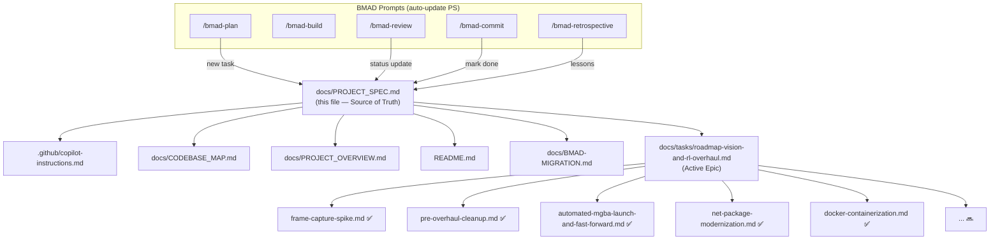

# Project Spec — PokemonRedRL

**Last updated:** 2026-10-11
**Active epic:** [roadmap-vision-and-rl-overhaul](docs/tasks/roadmap-vision-and-rl-overhaul.md)
**Next task:** Task 6 — Vision project + frame pipeline

> **What this file is.** The single source of truth for project state. Every BMAD phase updates it. Humans read it for context; machines read it for state. Never hand-edit the status fields — let the prompts do it.

---

## Quick Reference

| Artifact | Path | Role |
|---|---|---|
| Project conventions | [`.github/copilot-instructions.md`](.github/copilot-instructions.md) | Build/run commands, solution layout, BMAD workflow, Spec Law |
| Codebase map | [`docs/CODEBASE_MAP.md`](docs/CODEBASE_MAP.md) | File-by-file component inventory |
| Narrative overview | [`docs/PROJECT_OVERVIEW.md`](docs/PROJECT_OVERVIEW.md) | What/why, design tradeoffs, known gaps |
| BMAD config | [`_bmad/config.toml`](_bmad/config.toml) | Output folders, active initiative, language |
| BMAD migration | [`docs/BMAD-MIGRATION.md`](docs/BMAD-MIGRATION.md) | Old→new prompt mapping, setup instructions |
| Readme | [`README.md`](README.md) | Entry point for new contributors |

---

## Current State

### Stack
- **Runtime:** .NET 10.0 (LTS)
- **ML:** TorchSharp 0.107.0 (LibTorch 2.10.0, CUDA 12.8)
- **Database:** Redis Stack 7.4+ (RediSearch module required)
- **Emulator:** mGBA 0.10.5 (vendored, Windows)
- **UI:** WPF ControlPanel (`net10.0-windows`)
- **Containerization:** Docker Compose (Redis + Agent)

### Architecture (simplified)
```
mGBA (Lua bridge) ←→ .NET Agent (TCP) ←→ Redis Stack
                         ↕
                  WPF ControlPanel
```

### Key metrics
- **Frame capture:** OS-level `PrintWindow`, ~141–145 Hz (validated)
- **GPU:** RTX 4070 SUPER, CUDA available
- **Agents:** Configurable via `NUMBER_OF_AGENTS` (default 10)
- **Algorithm:** Double DQN + prioritized experience replay (SumTree)

---

## Completed Tasks (chronological)

> Archived task files live in [`docs/tasks/archive/`](docs/tasks/archive/). Active tasks stay in [`docs/tasks/`](docs/tasks/).

| # | Task | Slug | Status | Completed |
|---|---|---|---|---|
| — | Repository refactor + PROJECT_OVERVIEW doc | `repo-refactor-and-project-overview-doc` | ✅ Done | — |
| T1 | Frame-capture spike | `frame-capture-spike` | ✅ Done | OS `PrintWindow` validated at ~141–145 Hz |
| T2 | Pre-overhaul cleanup | `pre-overhaul-cleanup` | ✅ Done | Reward bug fixed, stale Lua removed, paths fixed |
| T2b | Desktop ControlPanel (WPF) | `automated-mgba-launch-and-fast-forward` | ✅ Done (MVP) | Manual attach mode; auto-launch blocked by mGBA 0.10.5 limitation |
| T3 | .NET & package modernization | `net-package-modernization` | ✅ Done | net8.0→net10.0, all packages current, CUDA verified |
| T3b | Docker containerization | `docker-containerization` | ✅ Done | `docker compose up` for Redis + Agent |

---

## Active Epic: Computer-Vision + RL Overhaul

**Epic file:** [`docs/tasks/roadmap-vision-and-rl-overhaul.md`](docs/tasks/roadmap-vision-and-rl-overhaul.md)
**Status:** In Progress (8/14 tasks done)
**Hard gate:** Task 3b ✅ (Docker Compose working — gate cleared)

### Task Status

| # | Task | Status | Depends on | Blocks |
|---|---|---|---|---|
| T1 | Frame-capture spike | ✅ Done | — | T4, T6 |
| T2 | Pre-overhaul cleanup | ✅ Done | — | T9 |
| T2b | ControlPanel (WPF) | ✅ Done (MVP) | — | T6 |
| T3 | .NET modernization | ✅ Done | — | All |
| T3b | Docker containerization | ✅ Done | — | T4 (HARD GATE) |
| **T4a** | **Remove OpenCV, adopt torchvision** | ✅ Done | — | T4 |
| T4 | Design vision+memory representation | ✅ Done | T1, T3b, T4a | T6, T8 |
| T5 | RL algorithm review | ✅ Done | — | T8 |
| T6 | Vision project + frame pipeline | ⬜ Planned | T1, T2b, T4 | T9 |
| T7 | Protocol verification + contract test | ⬜ Planned | T1 | — |
| T8 | Dual-modality network + trainer | ⬜ Planned | T4, T5 | — |
| T9 | Vision-aware reward shaping | ⬜ Planned | T2, T6 | — |
| T10 | Model persistence redesign | ⬜ Planned | — | — |
| T11 | Testing infrastructure (xUnit) | ⬜ Planned | — | — |
| T12 | Documentation catch-up | ⬜ Planned | All above | — |
| T13 | Headless mGBA in Docker | 🟢 Future | T8 | — |
| T14 | P/Invoke spike (mGBA as .so) | 🟢 Future | T13 | — |
| T15 | ControlPanel screenshot grid | 🟢 Future | T6 | — |
| T16 | PPO + LSTM spike | 🟢 Future | T8 | — |

### Key Decisions (from completed tasks + brainstorms)

| Decision | Source | Rationale |
|---|---|---|
| OS-level `PrintWindow` for frame capture | T1 | ~141–145 Hz vs ~1 Hz for `emu:screenshot()` |
| Window↔agent correlation via process handle | T1 | Window titles not distinguishable across instances |
| Manual mGBA attach only (no auto-launch) | T2b | mGBA 0.10.5 has no `--script` flag |
| Hybrid CNN+MLP architecture | Brainstorm | Industry standard for games with hidden state; pixels-only rejected |
| Feature flag `VisionEnabled` for baseline comparison | T4 | Without it, can't tell if vision helps |
| TorchSharp-only preprocessing (no OpenCV) | Brainstorm | `torchvision.transforms` covers Resize→Grayscale→Normalize |
| 84×84 grayscale frames | Brainstorm | Atari DQN standard, saves VRAM |
| Vision representation design (ADR) | [ADR 2026-10-11](docs/adr/2026-10-11-vision-representation.md) | F=2 frame-stack, M=14 memory, 512+64→576→256→6 fusion, [-1,1] normalization, A/B protocol |
| RL algorithm: Double DQN + Dueling + Noisy Nets (ADR) | [ADR 2026-10-11](docs/adr/2026-10-11-rl-algorithm-review.md) | PPO rejected (on-policy conflicts with Redis), N-step deferred, Distributional rejected. VRAM: 10 agents ~261 MB — fits easily. |
| Redis stays (Kafka rejected) | Brainstorm | Redis covers 5/5 use cases; Kafka covers 1/5 |
| mGBA stays (no emulator switch) | Brainstorm | Best Game Boy emulator with scripting API |
| Docker-first: `docker compose up` = everything | Brainstorm | Headless mGBA in Docker (T13), then P/Invoke (T14) |

### Open Risks

| Risk | Severity | Mitigation |
|---|---|---|
| GPU/VRAM budget for CNN across 10 agents | LOW | T5 analysis: ~261 MB for 10 agents, >10 GB headroom on RTX 4070 SUPER |
| Tensor leaks with frame tensors | HIGH | Soak-test in T6/T8; explicit disposal review |
| Redis payload size with frames | HIGH | Mandatory measurement in T8 before committing storage strategy |
| No CI/test infrastructure | MEDIUM | T11 adds xUnit; contract test in T7; skeleton created early |
| mGBA C API instability (P/Invoke) | MEDIUM | Pin mGBA version; spike first (T14); TCP+Lua is fallback |
| ControlPanel performance with 20 streams | MEDIUM | 5 fps/agent; WriteableBitmap pooling; Blazor Server as Plan B |

---

## BMAD Process Integration

### How this file stays in sync

Each BMAD prompt updates this file at specific checkpoints:

| Prompt | Updates |
|---|---|
| `/bmad-plan` | Adds new task row to Active Epic table; sets `_bmad/config.toml` → `active_initiative` |
| `/bmad-build` | No direct update (build works from plan file) |
| `/bmad-review` | Updates task status to `Reviewed` |
| `/bmad-commit` | Updates task status to `✅ Done`; moves to Completed Tasks; updates `Last updated` |
| `/bmad-retrospective` | Appends lessons to a `## Lessons Learned` section |
| `/bmad-architecture` | Adds row to Key Decisions table |
| `/bmad-brainstorm` | No direct update (output goes to `_bmad-output/`) |

### Conventions for machine readability

- Task statuses: `✅ Done`, `🔄 In Progress`, `🔜 Next`, `⬜ Planned`, `⏸️ Blocked`, `❌ Cancelled`
- Task IDs: `T1`–`T12` (stable, never renumbered)
- Epic status: `Not Started`, `In Progress (N/M tasks done)`, `Completed`, `Abandoned`
- Dates: `YYYY-MM-DD`
- File paths: relative to repo root, no `./` prefix

---

## Artifact Dependency Graph


