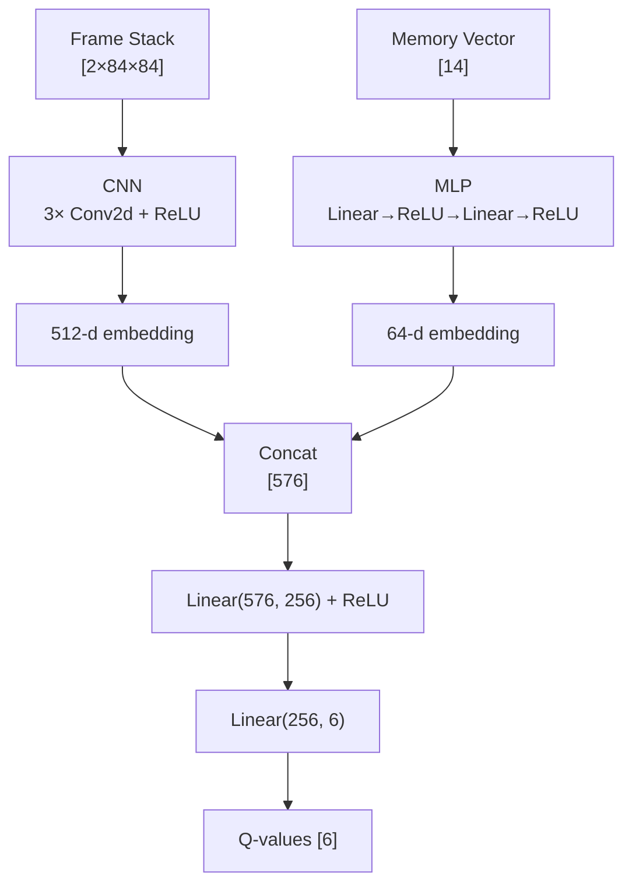

# ADR-0001: Combined Vision + Memory-State Representation for Pokémon Red RL Agent

**ID:** ADR-0001
**Date:** 2026-10-11
**Status:** Accepted
**Supersedes:** None (first ADR in this repo)
**Superseded by:** None

## Context

The PokemonRedRL agent currently perceives the game through a hand-crafted 14-float memory vector (`StatePreprocessorService.StateToTensor`): HP, MapId, X, Y, Direction, Badges, InTrainerBattle, Money, and 6 PartyLevels. This vector is precise but blind — the agent has no visual awareness of obstacles, NPCs, dialogue boxes, menus, or battle UI.

The [vision-and-rl-overhaul roadmap](../stories/roadmap-vision-and-rl-overhaul.md) bets that adding computer vision as a supplementary input will improve navigation, exploration, and ultimately the agent's ability to complete the game. The frame capture mechanism is already decided (OS-level `PrintWindow` at ~141-145 Hz, per the [frame-capture spike](../stories/archive/S1-frame-capture-spike.md)). What remains is the **representation design**: how vision and memory-state coexist as tensor inputs to the neural network.

This ADR settles all representation-level decisions so that S9 (vision pipeline) and S11 (dual-modality network) can be implemented independently and compose correctly at the fusion point.

### Constraints (non-negotiable)

- **Hybrid CNN+MLP** — pixels are supplementary, not a replacement for memory (per [brainstorm](../../_bmad-output/archive/brainstorms/BR-0002-full-architecture-review.md))
- **84×84 grayscale frames** — per brainstorm decision
- **TorchSharp-only preprocessing** — `torchvision.transforms`, no OpenCV (S6 already removed it)
- **Frame capture is OS-level `PrintWindow`** — independent of the Lua TCP bridge (S1 decision)
- **`Vision.Enabled=false` must produce bit-identical behavior to current code** — backward compatibility
- **No new NuGet packages** — TorchSharp covers CNN layers and transforms
- **No Lua protocol changes** — vision is a separate channel

### Relevant Spine Invariants

| # | Invariant |
|---|---|
| I1 | Game state is always read from mGBA memory via the Lua socket before any action |
| I2 | Tensor allocations in training loops must be disposed within the same iteration |
| I3 | Redis is the single source of truth for shared experience and hyperparameters |
| I4 | Vision capture is OS-level, independent of the Lua TCP bridge |
| I5 | `Vision.Enabled=false` path is bit-identical to current code |

## Decision

### 1. Vision Tensor Shape

```
Input: [2 × 84 × 84] float32, range [-1, 1]
  - 2 channels: frame-stack of F=2 consecutive grayscale frames
  - 84×84: spatial resolution (per brainstorm)
  - [-1, 1]: zero-centered normalization via Normalize(mean=[0.5], std=[0.5])
```

**Frame-stack depth F=2** (not Atari-standard F=4). Rationale: Pokémon Red's game logic is slow — the player moves one tile per ~16 frames, NPCs move infrequently, battles are turn-based. At 141 Hz capture, F=4 frames span only ~21ms of game time, providing redundant information. F=2 gives the minimum for motion detection (frame differencing → direction/speed) at half the VRAM cost. F can be increased later without architecture changes.

**Normalization to [-1, 1]** (not Atari-standard [0, 1]). Rationale: zero-centered inputs improve ReLU gradient flow. The Atari DQN used [0, 1] to match the original paper; we have no such constraint. `Normalize(mean=[0.5], std=[0.5])` maps grayscale [0, 1] → [-1, 1].

### 2. Memory Vector Composition

**M = 14 — all existing features kept.**

| # | Feature | Normalization | Rationale for keeping |
|---|---|---|---|
| 1 | HP | `/100f` | Numerical value in text box — CNN would need OCR |
| 2 | MapId | `/100f` | Categorical semantics — CNN sees tiles but doesn't know "this is Pallet Town" |
| 3 | X | `/20f` | Cheap (1 float), reliable, needed for reward shaping (visited locations) |
| 4 | Y | `/20f` | Same as X |
| 5 | Direction | `/3f` | Cheap, reliable — CNN can infer from sprite but explicit is free |
| 6 | Badges | `/8f` | Menu data — not visible on main screen |
| 7 | InTrainerBattle | binary | Precise boolean — battle UI is visible but flag is exact |
| 8 | Money | `/999999f` | Menu data — not visible on main screen |
| 9–14 | PartyLevels[0–5] | `/100f` | Menu data — not visible on main screen |

No features are dropped. The cost of keeping all 14 is negligible (14→128 = 1,792 params). The risk of dropping any is real — the CNN may never learn map identity, HP values, or badge counts from pixels alone. This is the core "hybrid" philosophy: memory gives exact numbers for free, vision gives spatial/contextual awareness.

### 3. Fusion Architecture

```
┌──────────────────────────────────────────────────────────────┐
│                   Vision Branch (CNN)                         │
│                                                              │
│  Input: [2 × 84 × 84]  (F=2 grayscale frames as channels)   │
│                                                              │
│  Conv2d(2, 32, kernel=8, stride=4)  → [32 × 20 × 20]       │
│  ReLU()                                                      │
│  Conv2d(32, 64, kernel=4, stride=2) → [64 × 9 × 9]         │
│  ReLU()                                                      │
│  Conv2d(64, 64, kernel=3, stride=1) → [64 × 7 × 7]         │
│  ReLU()                                                      │
│  Flatten()                            → [3136]               │
│  Linear(3136, 512)                    → [512]                │
│  ReLU()                                                      │
│                                                              │
│  Output: 512-d embedding                                     │
│  Params: ~1.68M                                              │
├──────────────────────────────────────────────────────────────┤
│                   Memory Branch (MLP)                         │
│                                                              │
│  Input: [14]  (existing memory vector)                       │
│                                                              │
│  Linear(14, 128)  → [128]                                    │
│  ReLU()                                                      │
│  Linear(128, 64)  → [64]                                     │
│  ReLU()                                                      │
│                                                              │
│  Output: 64-d embedding                                      │
│  Params: ~10K                                                │
├──────────────────────────────────────────────────────────────┤
│                      Fusion + Q-Head                          │
│                                                              │
│  Concat([512, 64])          → [576]                          │
│  Linear(576, 256)           → [256]                          │
│  ReLU()                                                      │
│  Linear(256, 6)             → [6]  (Q-values per action)     │
│                                                              │
│  Params: ~149K                                               │
├──────────────────────────────────────────────────────────────┤
│  Total: ~1.84M params                                        │
└──────────────────────────────────────────────────────────────┘
```



**CNN architecture:** Atari DQN standard (Mnih et al. 2015), adapted for F=2 grayscale input. The three Conv2d layers progressively reduce spatial dimensions (84→20→9→7) while increasing channels (2→32→64→64). The 512-d embedding provides sufficient capacity for Pokémon's diverse visual domains (overworld, battles, menus, caves).

**MLP architecture:** Unchanged from current `PokeDQN` — preserves the existing 14→128→64 path exactly.

**Fusion:** Concatenation (not addition) because the embeddings represent fundamentally different modalities. A learned Linear(576, 256) projects the combined representation before the Q-head.

**Parameter count:** ~1.84M total — modest. For comparison, Atari DQN is ~1.7M (with F=4, 4 actions). For 10 concurrent agents sharing one GPU, this is well within VRAM budget.

### 4. Vision.Enabled Feature Flag

```
appsettings.json:
{
  "Vision": {
    "Enabled": false    // default: safe, backward-compatible
  }
}
```

**DI-level gating, not runtime branching:**

| Vision.Enabled | Registered Services | Network |
|---|---|---|
| `false` | `IStatePreprocessorService` (existing), `INetworkService` → `MemoryOnlyNetworkService` | `PokeDQN` (existing, unchanged) |
| `true` | Above + `IVisionPreprocessorService` (real), `IVisionCaptureService` (real), `INetworkService` → `VisionNetworkService` | `PokeVisionDQN` (new, dual-modality) |

**`INetworkService` interface** (new, in `PokemonRedRL.Models.Interfaces`):

```csharp
public interface INetworkService
{
    Tensor Forward(Tensor state, Tensor? frame);
    // frame is null when Vision.Enabled=false
}
```

Two implementations:
- `MemoryOnlyNetworkService` — wraps `PokeDQN`, ignores `frame` parameter
- `VisionNetworkService` — wraps `PokeVisionDQN`, passes both inputs

**`ModelExperience` extension:**

```csharp
[Key(7)]
public byte[]? FrameBytes { get; set; }  // null when Vision.Enabled=false
```

Existing experiences without `FrameBytes` deserialize with it as `null` — backward-compatible, no migration needed.

**Backward compatibility (I5):** When `Vision.Enabled=false`:
- `MemoryOnlyNetworkService.Forward(state, null)` → `PokeDQN.Forward(state)` — identical to today
- `StatePreprocessorService.StateToTensor(state)` — identical to today
- No frame capture, no frame processing, no `FrameBytes` storage
- Bit-identical behavior to pre-S7 code

### 5. A/B Test Protocol

**Objective:** Determine whether vision improves navigation efficiency in a statistically and practically significant way.

| Parameter | Value |
|---|---|
| **Episodes per condition** | N = 50 (100 total) |
| **Starting state** | New Game, Professor Oak's lab, after receiving starter Pokémon |
| **Random seed** | Fixed (42) for both conditions |
| **Milestone** | Reach Route 3 (Viridian Forest exit) |
| **Termination** | Milestone reached, 10,000 steps, or HP=0 |
| **Primary metric** | Steps to milestone |
| **Secondary metrics** | Total reward, unique MapIds visited, battles won |
| **Statistical test** | Welch's one-tailed t-test, H₀: μ_vision ≥ μ_baseline, α=0.05 |
| **Success criterion** | p < 0.05 **AND** μ_vision ≤ 0.8 × μ_baseline |

**Why Route 3?** Pallet Town → Route 1 → Viridian City → Route 2 → Viridian Forest → Route 3 is navigation-heavy: narrow paths, grass patches, ledges, NPCs, and a maze (Viridian Forest). This is exactly where vision should help — the CNN can see obstacles and path geometry that the 14-float memory vector cannot represent.

**Why dual criterion?** Statistical significance alone (p < 0.05) is insufficient — with enough episodes, even a 1% improvement becomes "significant." The 20% practical threshold ensures the added complexity of the vision pipeline (frame capture, CNN, fusion) is justified by a meaningful improvement.

**Additional analysis:**
- Learning curves: moving average of steps-to-milestone over episodes
- Per-map heatmap: where does each condition spend time?
- Battle frequency: does vision lead to more/fewer wild encounters?

## Alternatives Considered

### Alternative 1: Pixels-only (no memory vector)

**Description:** Drop the memory vector entirely, use only CNN on frames (classic Atari DQN approach).

**Pros:**
- Simpler architecture — one input, one network
- No need to reverse-engineer memory addresses for new games

**Cons:**
- Must re-learn from pixels what memory gives for free (HP, badges, money, party levels)
- Menu data (badges, money, party) is not visible on the main screen — agent would need to learn to open menus
- Loses precise MapId/X/Y for reward shaping
- Much longer training time to reach baseline performance

**Why rejected:** The hybrid approach is the core bet of this epic. Memory gives exact numbers for free; vision adds spatial awareness. Throwing away memory is strictly worse.

### Alternative 2: F=4 frame-stack (Atari standard)

**Description:** Stack 4 consecutive frames instead of 2.

**Pros:**
- More motion information — can detect acceleration, longer trajectories
- Matches published Atari DQN results exactly

**Cons:**
- 2× VRAM for frame buffer (36 KB vs 18 KB per batch of 32)
- At 141 Hz capture, frames 1 and 4 are only ~21ms apart — player hasn't moved a full tile
- Pokémon Red's slow game logic doesn't benefit from fine-grained motion

**Why rejected:** F=2 provides sufficient motion information (direction, speed) at half the cost. Can be increased later if needed — one-line change in the preprocessor.

### Alternative 3: 256-d CNN embedding (smaller fusion)

**Description:** Reduce CNN embedding from 512-d to 256-d, fusion at 320→128→6.

**Pros:**
- Fewer parameters (~1.5M vs ~1.84M total)
- Lower VRAM, faster forward pass

**Cons:**
- Less capacity for Pokémon's diverse visual domains (overworld, battles, menus, caves)
- May bottleneck the vision signal — 256 dimensions for an 84×84 game screen is tight

**Why rejected:** ~1.84M params is already modest. If VRAM becomes an issue with 10 concurrent agents, reducing to 256-d is a one-line change. Start with more capacity, reduce if needed.

### Alternative 4: Addition fusion instead of concatenation

**Description:** Project both embeddings to the same dimension (e.g., 256-d) and add them, rather than concatenating.

**Pros:**
- Fewer fusion parameters (no 576→256 layer)
- Forces embeddings into a shared space

**Cons:**
- Addition assumes embeddings are commensurate — vision and memory are fundamentally different modalities
- Loss of information: addition discards which modality contributed what
- Harder to learn modality-specific features

**Why rejected:** Concatenation preserves all information from both branches and lets the fusion layer learn how to combine them. The extra ~148K params are worth it.

## Consequences

### Positive

- **S9 and S11 can be implemented independently.** The shape contract (CNN outputs 512-d, MLP outputs 64-d, fusion at 576→256→6) is the interface between the vision pipeline and the network. As long as both sides respect it, they compose correctly.
- **Backward compatible.** `Vision.Enabled=false` produces bit-identical behavior to current code. Safe to merge without disrupting existing training.
- **A/B testable.** The protocol provides a concrete, falsifiable test of whether vision helps. No subjective judgment needed.
- **Extensible.** Frame-stack depth, embedding sizes, and normalization can all be tuned without architecture changes. The `Vision` config section grows naturally as S9 adds capture parameters.

### Negative

- **~1.84M params** — larger than the current ~10K MLP. Training will be slower per step, though the richer input should improve sample efficiency.
- **`INetworkService` abstraction** adds an interface and two implementations — more files, more DI registrations. Worth it for clean gating, but adds complexity.
- **`FrameBytes` on `ModelExperience`** increases Redis storage per experience when vision is enabled. S11 will need to address storage strategy (likely separate frame keys with TTL).
- **Normalization constants in `StatePreprocessorService` remain ad hoc** (`x/20f`, `y/20f`). This ADR does not fix them — that's a separate cleanup task. The known issue is documented in the code and in `PROJECT_OVERVIEW.md` §5.

### Neutral / Notes

- The CNN architecture (Atari DQN standard) is a starting point. If training reveals that 3 Conv2d layers are too shallow for Pokémon's visual complexity, adding residual connections or increasing depth is a future optimization — not a design change.
- The A/B test protocol uses Route 3 as the milestone. If the agent never reaches Route 3 in 50 episodes (unlikely but possible), the milestone can be downgraded to Viridian City (Route 1 exit) — a simpler navigation task.
- This ADR does not specify the RL algorithm (DQN, Double DQN, Dueling, PPO). The fusion point (before the Q-head) is algorithm-agnostic — S8 will decide the algorithm, and the representation design here works with any of them.

## Migration Path

This is a design-only ADR — no code changes. Implementation order:

1. **S9 (Vision project + frame pipeline):** Implement `IVisionPreprocessorService` producing `[2×84×84]` tensors per this ADR. Implement `IVisionCaptureService` using `PrintWindow`. Add `Vision` config section to `appsettings.json`.
2. **S11 (Dual-modality network):** Implement `PokeVisionDQN` with the CNN+MLP+fusion architecture specified here. Implement `INetworkService` and both implementations. Wire up DI gating in `Program.cs`.
3. **S12 (Vision-aware reward shaping):** Use frame embeddings for novelty/progress signals — out of scope for this ADR.
