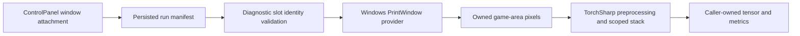

# ADR-0003: Host-Local Vision Frame Pipeline

**ID:** ADR-0003
**Date:** 2026-10-30
**Status:** Accepted
**Supersedes:** None
**Superseded by:** None
**Story:** [S9](../stories/archive/S9-vision-project-frame-pipeline.md)

## Context

ADR-0001 defines the representation but not the capture boundary. ControlPanel has PID/HWND slot associations and WPF previews, while Agent targets net10.0 and also runs on Linux Docker. Agent currently starts before the final manifest save; subsequent window attachment updates the in-memory slot without saving it. The training pipeline cannot assume that association is already persisted.

S9 provides capture and preprocessing through a diagnostic consumer. S11 integrates vision with learning. The user approved this architecture and creation of its record on 2026-10-30. The initial record passed formatting validation before acceptance.

## Invariants and Seed Facts

### Invariants

- Memory-only state, learner, rewards, Lua commands, and Redis payloads remain unchanged.
- Frames use PrintWindow independently of the Lua bridge; preprocessing uses TorchSharp/torchvision and produces chronological float32 [2,84,84] tensors in [-1,1].
- Each agent owns its capture/stack state; resources have explicit owners and bounded retention.
- Windows capture must not force WPF or a Windows-only target into the Linux memory-only Agent.

### Seed Facts

- ControlPanel currently launches one Agent per slot using host/port/index, not manifest identity.
- Its BitmapSource preview service is a UI adapter, not a training input contract.
- Attached windows can be resized, minimized, closed, or replaced, and previews are paginated.

## Decision

### Boundaries and Data Flow

Add one net10.0 PokemonRedRL.Vision project without WPF or System.Drawing dependencies. IFrameProvider returns owned CPU pixel data and capture metadata or an explicit unavailable result. IVisionPreprocessorService owns only the two-frame per-agent stack and produces a caller-owned tensor when ready. Native capture is guarded by an explicit Windows platform check; preprocessing and contract tests remain platform-independent.

Agent's diagnostic invocation supplies an absolute manifest path, slot index, and bounded duration/rate. Validate the selected slot against explicit host/port identity and the live PID/HWND ownership. Reject missing, duplicate, stale, or mismatched associations rather than selecting by title or scanning ports. This validates the operator-selected association; it does not independently prove which bridge port a manually attached emulator serves.

ControlPanel persists the association immediately after attachment, using a complete-file replacement so readers cannot observe a partial write. Diagnostic capture starts only after a valid saved association exists. Ordinary memory-only startup does not wait for a window. No new UI workflow or automatic emulator startup is introduced.

### Game Viewport

Prefer an unambiguously identified child render area belonging to the selected emulator process. If it cannot be identified reliably, require an explicit game rectangle relative to the captured client area, with bounds checked on every capture. Do not infer the viewport by trimming black pixels, since black can be valid game content. Ambiguous geometry, resize invalidation, minimized windows, and capture API failures return unavailable. Verify actual pixels visually; successful PrintWindow alone does not establish image correctness or freshness.

### Temporal and Resource Contract

- The stack becomes ready only after two successful captures, ordered oldest to newest; do not duplicate the first frame.
- Reset, identity/geometry change, or capture failure clears history. No prior-episode frame or another slot's frame may remain.
- Capture occurs on request, with no background frame queue and no sustained backlog. Metrics distinguish requested captures, failures, completions, and missed deadlines.
- The service retains at most two processed frames. Returned stacks do not alias mutable internal storage and belong to the caller, which disposes them.
- Dispose temporary tensors within each operation, retain only explicitly owned stack tensors, and release GDI/DC/bitmap resources on every failure path.
- Cancellation is checked between native calls. Do not claim a hard deadline or safe forced cancellation for a blocked PrintWindow call; document that remaining limitation.

### Configuration and Deployment

Vision.Enabled defaults to false. Composition must load the intended configuration independently of the per-slot working directory, preserving existing host configuration precedence. An explicit diagnostic mode constructs only the capture/preprocessing services: it must branch before Redis connection, maintenance, scheduler loading, or learner initialization.

Enabled ordinary training is rejected clearly until S11; it must not claim vision training while silently ignoring frames. Enabled diagnostics on non-Windows fail before native resource allocation. Disabled Linux Docker operation remains supported; update Dockerfile's project-copy/restore inputs when Agent references Vision.

### Dependencies and Verification

Reuse existing TorchSharp production dependencies and framework interop. The approved focused xUnit project may add test-only packages: this clarifies ADR-0001's dependency constraint for verification without adding production dependencies or replacing its representation decision.

**Approved dependency correction, 2026-10-30:** compilation and package inspection established that torchvision.transforms requires the separate TorchVision package. The user explicitly approved TorchVision 0.107.0 in PokemonRedRL.Vision and continued implementation. This narrowly relaxes ADR-0001's no-new-packages constraint to implement its chosen transforms; all representation decisions remain intact. No other new production package is authorized by this correction.

Fixture tests cover identity selection, geometry bounds, channel ordering, dtype/range, warm-up, reset/failure, independent scopes, caller ownership, and repeated cleanup. Live measurements and visual inspection cover native capture correctness, DPI/window states, preview contention, 1/3/10 concurrency, and resource soak. A build alone is insufficient evidence. Record environment blockers without marking unexecuted live checks passed.

## Alternatives Considered

- Reuse the WPF preview service directly: rejected because BitmapSource and UI lifetimes would couple the Agent to Windows Desktop and dashboard pagination.
- Move capture to ControlPanel and stream frames to Docker: deferred because it adds transport, synchronization, backpressure, and failure contracts beyond S9.
- Retarget Agent to net10.0-windows: rejected because it breaks the Linux memory-only deployment.
- Capture the entire client area or trim dark borders heuristically: rejected because menus and real black game pixels would corrupt inputs.
- Duplicate or reuse old frames after failures: rejected because it hides unavailable input and weakens temporal semantics.
- Unbounded asynchronous capture queue: rejected because old images and resource growth are unacceptable; requested rates are measured rather than guaranteed.

## Consequences, Risks, and Migration

The diagnostic boundary lets S9 verify production interfaces before S11 changes learning. Windows desktop availability remains mandatory for capture, and remote/container vision is not delivered. Live viewport discovery may require explicit geometry; unsupported states fail clearly instead of guessing.

Manual window attachment remains an operator assertion about the emulator/port relationship. PID/HWND checks prevent detectable stale associations but are not an authenticated game-to-port identity protocol. Native calls can still block; soak and latency evidence must report this limit honestly.

Implement in plan order, verify after each slice, preserve old manifest readability with additive fields only where needed, and update producer and consumer together. No Redis migration, Lua protocol change, or replay/checkpoint migration occurs in S9. S11 consumes the tensor interface and owns enabling the vision learner.